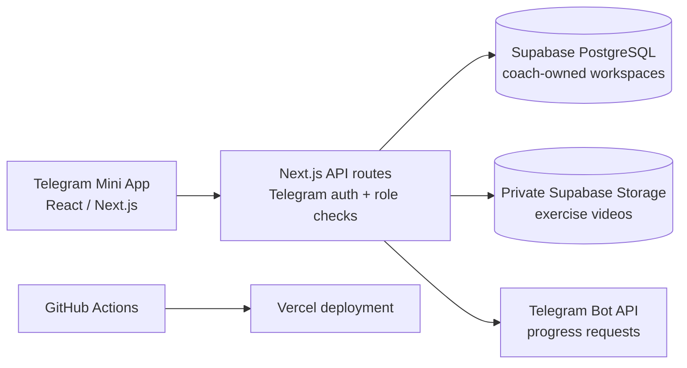

<div align="center">

# ↗ Fat2Fit

### Personal training, without the spreadsheet chaos.

**A Telegram Mini App for coaches and their students — designed, built and shipped from 0 → 1.**

**Live private pilot** · **v0.8** · **RU / EN / CG**

[**Product case study**](docs/CASE_STUDY.md) · [**Architecture**](docs/ARCHITECTURE.md) · [**Open Telegram app ↗**](https://t.me/fat2fitapp_bot/Fat2Fitgymapp)

<sub>The live app is invite-only. Reviewers can explore the UI using the local demo instructions below.</sub>

</div>

---

## The product, in 30 seconds

Personal trainers often manage workout plans, exercise notes, videos, progress measurements and student conversations across several disconnected tools. That adds friction for both sides.

**Fat2Fit brings the core coaching workflow into Telegram**, where coaches and students already communicate.

| For coaches | For students |
| --- | --- |
| Manage a private list of clients | Open assigned workouts directly in Telegram |
| Create, edit and reuse exercise libraries | Track sets, reps, weights and completion |
| Build templates **or** assemble ad-hoc workouts | Submit technique videos for feedback |
| Review workouts and videos, with separate queues | Record weight, body measurements and muscle mass |
| See today's and tomorrow's training workload | Compare first and latest measurements |
| Request monthly measurement reports | Control which coach workspace is currently active |

**Product principle:** *Make it easier to train together than to coordinate the training.*

## Product walkthrough

```text
COACH                                         STUDENT

Invite student via Telegram ────────────────► Join the coach's workspace
Create exercises / build a workout ─────────► See the assigned workout
Review completed sets ◄────────────────────── Log sets, reps and weight
Review technique video ◄──────────────────── Upload a private video
Request monthly progress report ───────────► Submit body measurements
Track the coaching workload ◄──────────────── Review feedback and progress
```

Everything relevant to a particular coach–student relationship stays within that coach's workspace. A student can work with more than one coach without merging the coaching relationships or monthly reports.

## What is implemented

- **Telegram-native onboarding:** verified Telegram `initData`, signed HttpOnly sessions and expiring one-use invitations.
- **Workout planning:** reusable templates, custom exercise definitions, ad-hoc assignments, workout categories and coach self-training.
- **During a session:** actual vs. planned sets, repetitions and weights, with coach-assisted logging.
- **Async feedback:** private technique-video uploads, coach review, comments and a separate approval flow for completed workouts.
- **Body progress:** dated measurements, historical records and a first-to-latest comparison without imposing a universal “good” direction.
- **Coach action center:** four simultaneous counters for today, tomorrow, workouts awaiting review and videos awaiting review.
- **Monthly check-ins:** a calendar-month schedule tied to each individual coach–student relationship, with Telegram requests initiated by the coach.
- **Granular access:** coaches can choose whether a student sees full workout history or only completed-session totals by category.
- **Localized mobile UI:** Russian, English and Montenegrin (Latin), designed around Telegram WebView on phones.

## Why this is a product-management case

I used Fat2Fit to work through the complete product loop: **problem → MVP → architecture → implementation → deployment → real-user feedback → iteration**.

Several changes came directly from using the app with actual coaching scenarios: a coach needed to log his own workouts, workouts should not always require templates, exercise descriptions needed editing, and mobile navigation/date inputs needed fixes on iOS.

The challenge was not just to build screens. It was to **design a permission model, prioritize the smallest useful workflows and keep a working production pilot while iterating.**

[**Read the full case study →**](docs/CASE_STUDY.md)

## Architecture at a glance



**Stack:** Next.js 16 · React 19 · TypeScript · Node.js 24 · PostgreSQL · Supabase · Telegram Web Apps · Vercel · GitHub Actions.

Selected engineering choices:

- Server-side verification of Telegram authentication; the browser does not hold the bot token or database credentials.
- Coach-owned workspaces and role checks for the relevant data-access routes.
- Signed URLs for uploading/playing videos from private storage.
- Immutable assignment copies so changing a workout template does not retroactively rewrite an assigned session.
- Automated tests covering Telegram validation, data shapes, deployment prerequisites and calendar-month reporting rules.

[**Architecture notes →**](docs/ARCHITECTURE.md) · [**Acceptance checklist →**](docs/fat2fit-08-acceptance.md)

## Try it

### Live app

[**Open Fat2Fit in Telegram ↗**](https://t.me/fat2fitapp_bot/Fat2Fitgymapp)

Production access is deliberately invitation-based. Opening the app without a coaching invitation is **not** a public demo.

### Run the local UI demo

Requires **Node.js 24**.

```bash
git clone https://github.com/xD1v3R-kdm/Fat2Fit.git
cd Fat2Fit
npm install
cp .env.example .env.local
# Keep NEXT_PUBLIC_DEMO_MODE=true for the offline local demo
npm run dev
```

Open `http://localhost:3000`. The demo uses sample data; it does not connect to the production database or Telegram account. **Do not commit `.env.local`.**

```bash
npm test              # Automated unit checks
npm run typecheck     # TypeScript validation
npm run build         # Demo-mode build when .env.local enables demo mode
```

Production deployment requires private environment variables configured outside Git. See the intentionally sanitized [environment template](.env.example).

## Project structure

| Path | Purpose |
| --- | --- |
| `src/components/Fat2Fit.tsx` | Coach/student interface and mobile workflows |
| `src/app/api/` | Authenticated application API |
| `src/lib/` | Telegram verification, sessions, data access and business rules |
| `supabase/migrations/` | Versioned database evolution |
| `tests/` | Automated checks |
| `.github/workflows/` | CI validation |
| `docs/` | Product case study, architecture and release acceptance |

## Status & transparency

**Status:** deployed and used in a small, invite-only pilot. This is a working side project, not a commercial SaaS launch. I am **not** claiming validated retention, revenue, acquisition or performance improvements. Some cross-account, Telegram delivery and mobile edge cases remain subject to ongoing user testing.

**Development:** product direction, user journeys, prioritization and acceptance criteria were driven by me; implementation was iterated with AI-assisted development and direct testing. This repository is presented as a **product-building and product-leadership case**, not as evidence of unaided authorship of every line.

---

**Built by [Dmitry Komkov](https://www.linkedin.com/in/dmitrykomkov/)** · Product leadership, 0 → 1 and delivery systems

[Portfolio](https://dmitrykomkov.netlify.app) · [LinkedIn](https://www.linkedin.com/in/dmitrykomkov/) · [Contact](mailto:komkov.kdm@gmail.com)

<sub>Portfolio source. No open-source license is currently granted; please contact the author about reuse. No user data, access tokens or database passwords should be committed to this repository.</sub>
