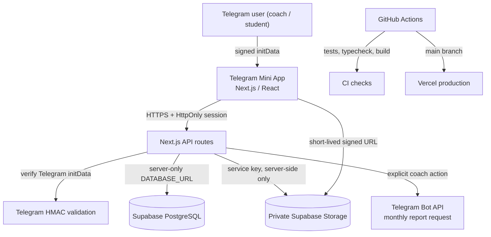
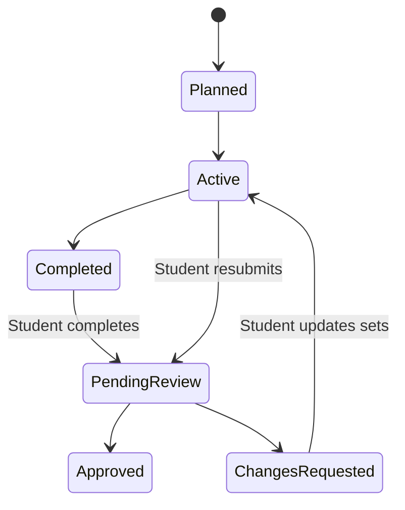
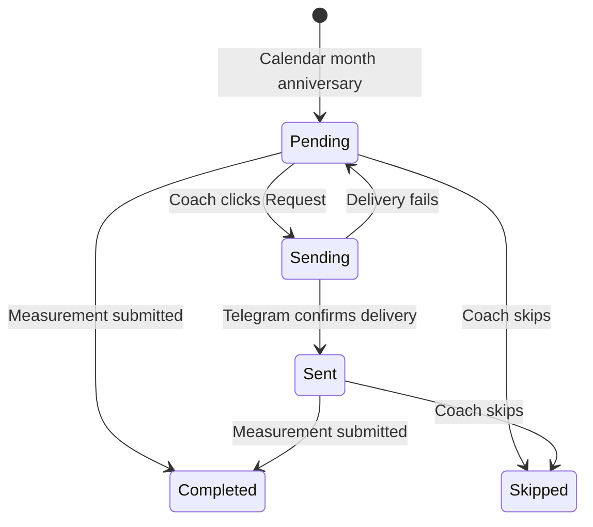

# Fat2Fit — Technical architecture

[← Project overview](../README.md) · [Product case study](CASE_STUDY.md)

## System overview



The Telegram client has no database credentials, service-role key or bot token. API requests rely on a signed session and are checked against server-side roles and workspace membership.

## Core domains

| Domain | Main records | Purpose |
| --- | --- | --- |
| Identity | `users`, `memberships` | Telegram users and roles |
| Coach relationships | `workspaces`, `invitations` | One coach-owned workspace; many students, potentially in several |
| Exercise library | `exercises`, `exercise_overrides` | Shared catalogue plus coach-specific metadata |
| Planning | `workout_templates`, `template_exercises` | Reusable programming |
| Execution | `assignments`, `assignment_exercises`, `set_logs` | Per-student plans and actual results |
| Feedback | `workout_videos`, assignment review fields | Coach feedback, statuses and private playback |
| Progress | `body_measurements`, `measurement_requests` | Historical metrics and coach-specific monthly reporting |

## Tenancy and role boundaries

Each workspace has one `owner_user_id` (coach). A student can be a member of multiple independent workspaces, but each coaching relationship has its own assignments and progress records.

A server route must check both:

1. **Who is making the request?** Verified signed session.
2. **Does that user have permission for this workspace, student and resource?** Role + ownership checks + SQL scope.

**Important qualification:** the app uses server-side PostgreSQL credentials, with client `anon` / `authenticated` grants revoked and RLS enabled. In this architecture, *application-layer authorization is essential*; enabling RLS alone is not sufficient evidence that multi-tenant endpoints are secure. A dedicated penetration review is still future work.

## Workflow states

### Workouts



Workout execution and coach review are represented by **separate fields**. An approved workout does not lose its completion record.

### Monthly progress requests



Each record is unique by `(workspace_id, student_user_id, due_on)`. Due dates use **calendar months**, not an assumed 30-day period. Overdue requests remain visible until completed or skipped.

## Media

Workout videos use a **private Supabase Storage bucket** with temporary upload/playback URLs. File metadata and review state are stored in PostgreSQL. The app restricts file types and sizes; uploaded media is not published as a static website asset.

## Running and validating

```bash
npm install
cp .env.example .env.local
# Set NEXT_PUBLIC_DEMO_MODE=true for local sample data
npm run dev

npm test
npm run typecheck
npm run build
```

CI runs unit checks and a demo-mode build without production credentials. Production secrets are configured in Vercel and never belong in commits.

**Limitations:** Automated checks cover selected validation and business rules; they do not substitute for exhaustive API authorization tests, full Telegram E2E tests or an independent security audit.

[← Back to README](../README.md)
